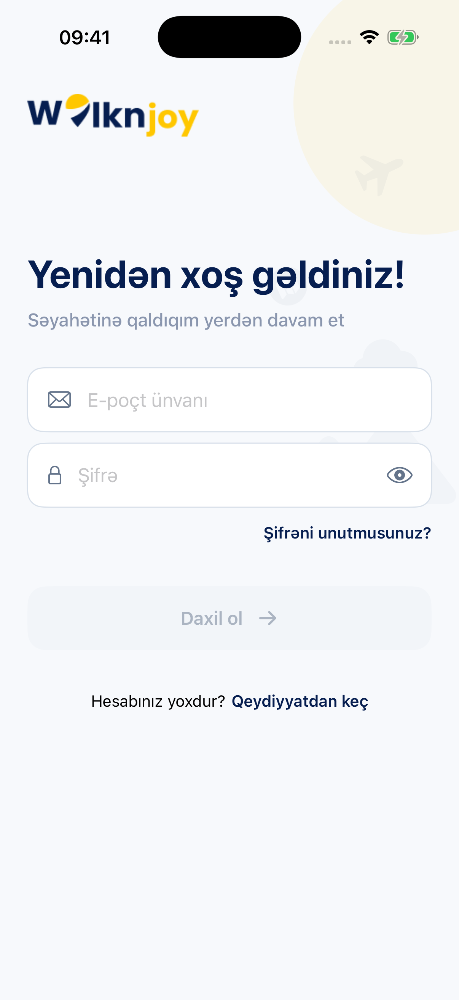
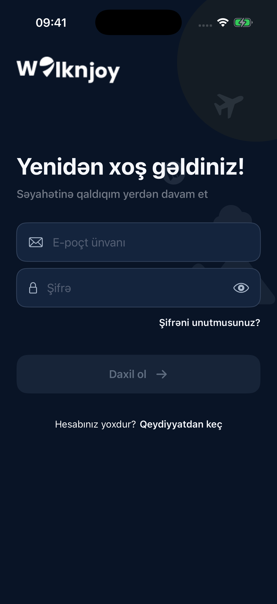

# WalkNJoy iOS

[](https://github.com/TogrulEminov/walknjoy-app/actions/workflows/ios-ci.yml)

WalkNJoy Azərbaycanda qalmaq, tur, fəaliyyət və təcrübə xidmətlərini tapmaq, seçimlər əsasında səyahət planlaşdırmaq və rezervasiya etmək üçün SwiftUI tətbiqidir. Layihə [TogrulEminov/walknjoy-app](https://github.com/TogrulEminov/walknjoy-app) şəxsi reposunda saxlanılır.

## Ekran görüntüləri

Təmiz iPhone 17 Pro simulator-unda çəkilmiş giriş ekranları. Screenshot-larda istifadəçi hesabı və şəxsi məlumat yoxdur.

 

## Funksionallıq

- Onboarding, dil seçimi, giriş, qeydiyyat, OTP və şifrə bərpası.
- Ana səhifə, şəhər və kateqoriyalar, axtarış, qiymət və tarix filtrləri, listing detalları.
- Seçimlərə əsaslanan Travel Planner: istiqamət, tarixlər, qonaqlar, büdcə, maraqlar, xülasə və nəticələr. Hesab üzrə sessiya bərpası, geri/sıfırlama və candidate pagination.
- Stay və session booking, availability yoxlaması, booking detalları və PDF bilet.
- Rəylər, sevimlilər, bildirişlər və bildiriş seçimləri.
- Profil, avatar, təhlükəsizlik və görünüş parametrləri.
- Provider müraciəti, profil və listing idarəetməsi.
- Azərbaycan, ingilis və rus dilləri; açıq, qaranlıq və sistem teması.

Server məlumatları və autentifikasiya tələb edən funksiyalar üçün ayrıca WalkNJoy backend-i lazımdır. Backend bu repoya daxil deyil.

## Texnologiyalar və arxitektura

**SwiftUI**, **MVVM**, **Observation**, **Swift Concurrency (async/await)**, **URLSession**, **Codable**, **Decimal**, **Keychain**, **UserDefaults**, **NavigationStack**, **PhotosUI**, **MapKit** və **PDFKit** istifadə olunur.

Məlumat axını: `View → ViewModel → Service protocol → Service → NetworkingService → Endpoint`.

View-lar layout, binding və naviqasiya göstərir. ViewModel-lər sorğuları, input validation, loading/error/empty vəziyyətlərini və məlumat hazırlığını idarə edir. Service-lər protocol vasitəsilə inject edilir. Ortaq `LoadState`, `RequestState`, `PaginationController`, form validation və tema komponentləri təkrar istifadə olunur. Planner sessiya yaddaşı da ayrıca `PlannerSessionStoring` protocol-u ilə inject edilir.

Adi mətn və şifrə sahələri native SwiftUI-dır. UIKit ekran arxitekturası kimi istifadə edilmir: xüsusi telefon maskası və OTP giriş koordinasiyası `UIViewRepresentable`, PDF görünüşü və paylaşımı isə PDFKit/`UIViewControllerRepresentable` adapterləri ilə qoşulur. `UIImage` avatar decode və cache qatında istifadə olunur.

Swift Package Manager asılılıqları: **SDWebImageSwiftUI/SDWebImage**, **SnapKit**, **InputMask** və **SwiftRichHTMLEditor**. Dəqiq versiyalar `Package.resolved` daxilində sabitlənib. SnapKit mövcud xüsusi UIKit giriş adapterləri üçündür.

```text
walknjoy/
  walknjoy.xcodeproj/          Xcode layihəsi, shared scheme və Package.resolved
  walknjoy/
    App/                      Başlanğıc, app state və navigation
    Core/
      Components/             Ortaq SwiftUI UI komponentləri
      Models/                 DTO və domain modelləri
      Networking/Endpoints/   HTTP request təsvirləri
      Services/               Protocol-lar və server inteqrasiyası
      State/                  Loading, request və pagination vəziyyətləri
      Storage/                Keychain, preferences və planner sessiyaları
      UI/SwiftUIBridge/       Xüsusi native komponent adapterləri
    Features/
      Auth/ Home/ Search/ ListingDetail/ Bookings/ Reviews/
      TravelPlanner/          View, ViewModel və kiçik ekran komponentləri
      Notifications/ Profile/ Provider/
    Assets.xcassets/           Şəkillər və light/dark rənglər
    Localizable.xcstrings      AZ / EN / RU mətnləri
config/                       Təhlükəsiz APIConfig nümunəsi
scripts/                      Lokal və CI üçün konfiqurasiya hazırlığı
docs/screenshots/             README ekran görüntüləri
.github/workflows/            GitHub Actions
```

## Quraşdırma və işə salma

1. **Xcode 26.4+**, **iOS 26.4+ simulator** və paketlərin ilk yüklənməsi üçün internet lazımdır.
2. Reponu klonlayın və konfiqurasiyanı hazırlayın:

```bash
git clone https://github.com/TogrulEminov/walknjoy-app.git
cd walknjoy-app
sh scripts/prepare-config.sh
open walknjoy/walknjoy.xcodeproj
```

3. `walknjoy/walknjoy/Core/Config/APIConfig.swift` daxilində `baseURL` və `imageUrl` dəyərlərini öz backend/media mühitinizə uyğunlaşdırın. Nümunədə `http://localhost:8000/api/v1` və şəkillər üçün placeholder URL var. `imageUrl` üçün real media base URL yazın.
4. Xcode-da `walknjoy` scheme-i və iOS simulator seçib Run edin. Fiziki cihaz üçün öz signing team-inizi seçin və `localhost` yerinə backend-in cihazdan əlçatan ünvanını yazın.

Hazırlıq skripti mövcud lokal konfiqurasiyanı əvəz etmir. `APIConfig.swift` Git-də izlənmir; nümunə faylı isə repoda saxlanılır. Konfiqurasiyaya server parolu, private key və ya digər server sirləri yerləşdirməyin. Yeni public konfiqurasiya sahəsi əlavə ediləndə nümunəni də yeniləyin.

## Build və GitHub Actions

```bash
sh scripts/prepare-config.sh
xcodebuild build \
  -project walknjoy/walknjoy.xcodeproj \
  -scheme walknjoy \
  -configuration Debug \
  -destination 'generic/platform=iOS Simulator' \
  -onlyUsePackageVersionsFromResolvedFile \
  CODE_SIGNING_ALLOWED=NO
```

`iOS CI` hər **push** və **pull request** zamanı avtomatik işləyir; `workflow_dispatch` ilə əl ilə də başladılır. `macos-26` üzərində Xcode 26.4.1 istifadə edərək Debug və Release build-lərini yoxlayır. Paketlər resolved fayldakı versiyalarla yüklənir. CI nümunədən müvəqqəti API konfiqurasiyası yaradır; backend, signing sertifikatı və GitHub Secrets tələb olunmur. Runner-dəki Xcode versiyası [rəsmi runner siyahısı](https://github.com/actions/runner-images/blob/main/images/macos/macos-26-Readme.md) ilə yoxlanıla bilər.

**Test vəziyyəti:** shared scheme-də hazırda unit/UI test target-ləri yoxdur. Bu workflow build yoxlamasıdır, unit və UI test keçidi kimi təqdim edilmir. Test target-ləri əlavə olunanda `xcodebuild test` mərhələsi də əlavə edilməlidir. Hazırkı build yoxlaması qiymətləndirmənin ayrıca məcburi test şərtini ödəmir.

## İnkişaf qaydası

Dəyişiklikləri funksional mövzuya görə kiçik, mənalı commit-lərlə saxlayın: feature, refaktor, CI düzəlişi və sənədləşmə. Mövcud commit tarixçəsi saxlanılır; tarixlər geriyə çəkilmir və saxta tarixçə yaradılmır. Feature və konfiqurasiya dəyişəndə README-nin əlaqəli bölməsini də yeniləyin.
